# step2html — STEP → self-contained 3D HTML viewer

Converts a **STEP** CAD file (`.step` / `.stp`, ISO 10303) into a **single, self-contained
HTML file** that displays the 3D model in any modern browser, with a **CAD-style parts tree**
(select, highlight, hide, isolate), exploded view, measurements and lighting presets. The output has
no external dependencies — three.js, the loader, the geometry and the part names are all embedded —
so it works offline and by simply opening the file (`file://`). Send it to anyone: no CAD software,
plugin or account is needed to look at the model, on **desktop and mobile/tablet** browsers (touch
supported).

Use it from the **Step2HTML desktop app** or the **`step2html` command line**.

<p align="center">
  
</p>

<p align="center">
  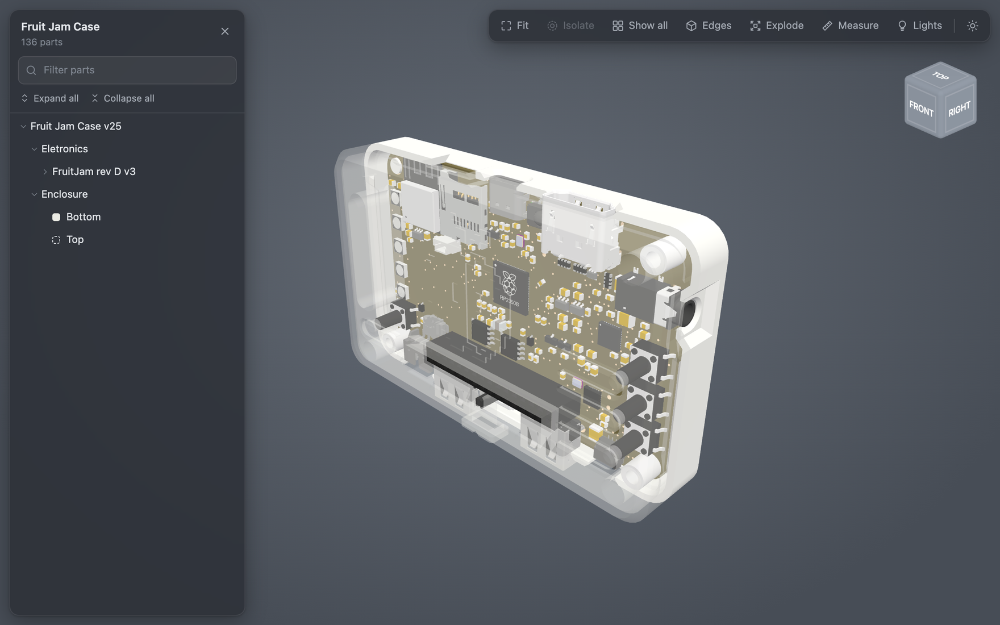
</p>

### Supported platforms

| | Desktop app | Command line |
|---|---|---|
| **macOS** | `.dmg` (Intel; runs on Apple Silicon via Rosetta) | ✓ |
| **Linux** | `.deb` (Debian, Ubuntu, Mint, …), `.pkg.tar.zst` (Arch, Manjaro, …), portable `.tar.gz` (x86-64) | ✓ |
| **Windows** | installer `Setup.exe` or portable `.zip` (x64) | ✓ (bundled with the app as `step2html-cli.exe`) |

The generated viewer runs in any current browser — Chrome, Edge, Firefox, Safari — including iOS
and Android.

## Usage

### Desktop app

Choose (or drop) a STEP file, pick where to save, press **Create viewer**. Options: viewer title
and mesh detail (Coarse / Standard / Fine). The app follows the system's light/dark mode and can
open the result in the browser when done.

- **macOS**: open `Step2HTML-<version>-macos-x86_64.dmg` and drag the app to Applications. It isn't
  notarized, so on first launch of a downloaded copy: right-click → **Open**.
- **Linux**: install the `.deb` (`sudo apt install ./step2html_<version>_amd64.deb`) or the Arch
  package (`sudo pacman -U step2html-<version>-1-x86_64.pkg.tar.zst`); both also install the
  `step2html` command. Or unpack the portable `.tar.gz` and run `step2html-gui`.
- **Windows**: run `Step2HTML-<version>-Setup.exe` (per-user install, no admin rights needed) or
  unpack the portable `.zip`. The packages are unsigned, so SmartScreen asks once:
  **More info → Run anyway**.

Everything is bundled (no Python setup needed).

### Command line

```bash
./step2html my_assembly.step
# -> writes my_assembly.html next to the input

./step2html my_assembly.stp -o viewer.html --title "My Assembly"
```

From a source checkout, the first run creates a local virtual environment in `./.venv` and installs
the one dependency ([`cadquery-ocp`](https://pypi.org/project/cadquery-ocp/), the OpenCASCADE
bindings — a few hundred MB, downloaded once). Later runs reuse it. The Linux packages install the
same command as `step2html`.

| Option | Default | Meaning |
|---|---|---|
| `-o, --output PATH` | `<input>.html` | Output HTML path |
| `--title TEXT` | input file name | Label shown in the viewer |
| `--tol-linear N` | `0.2` | Linear tessellation deflection (model units). Smaller = finer mesh, bigger file |
| `--tol-angular N` | `0.5` | Angular tessellation deflection (radians) |
| `--keep-glb PATH` | — | Also write the intermediate `.glb` |
| `--version` | — | Print the version and exit |

### Viewer controls

#### Navigate

**Rotate**: drag (one finger on touch) · **Pan**: right-drag / two-finger drag · **Zoom**: scroll /
pinch. **Fit** (toolbar or `F`) frames the whole model, or the selection if there is one.

#### Select a part

Click or tap a part in the 3D view to select and highlight it; the tree scrolls to it. Click a name
in the tree to select it there; double-click to zoom to it. `Esc` deselects.

<p align="center">
  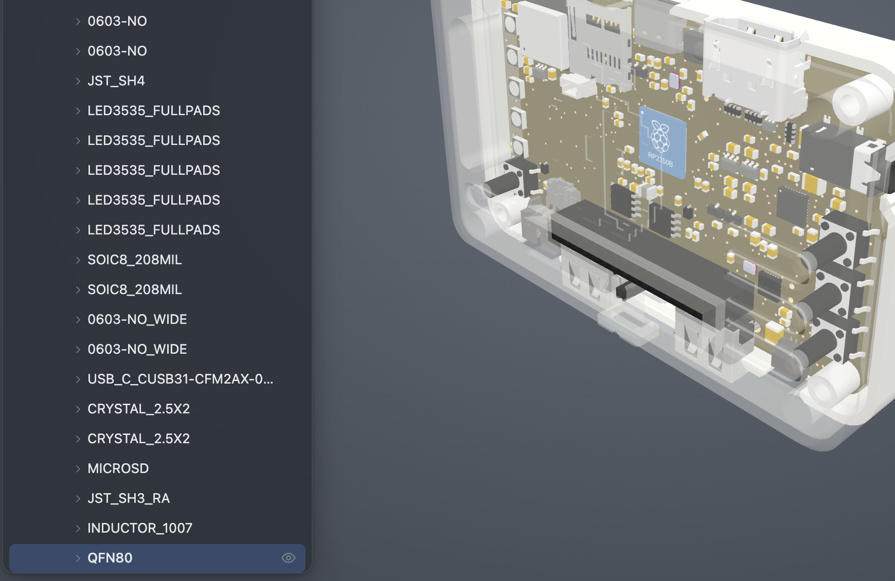
</p>

#### Select several parts

In the tree, **Shift-click** selects a range and **Cmd-click** (Mac) / **Ctrl-click** (Windows,
Linux) adds or removes a part. In the 3D view Cmd/Ctrl-click adds or removes (on a Mac Ctrl-click
stays the right-click menu). The right-click menu, Isolate, Fit and the `H` / `T` / `I` / `F` keys
then act on all selected parts.

<p align="center">
  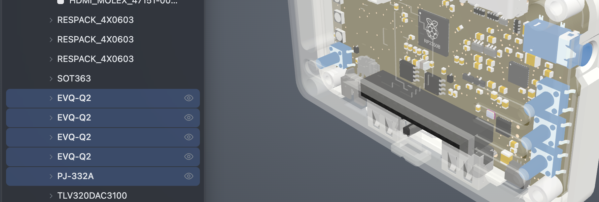
</p>

#### Right-click menu

Right-click a part (or **long-press** on touch), in the 3D view or in the tree: **Hide** ·
**Make transparent / solid** · **Hide others** · **Zoom to part** · **Show all**
(· **Make all solid**).

<p align="center">
  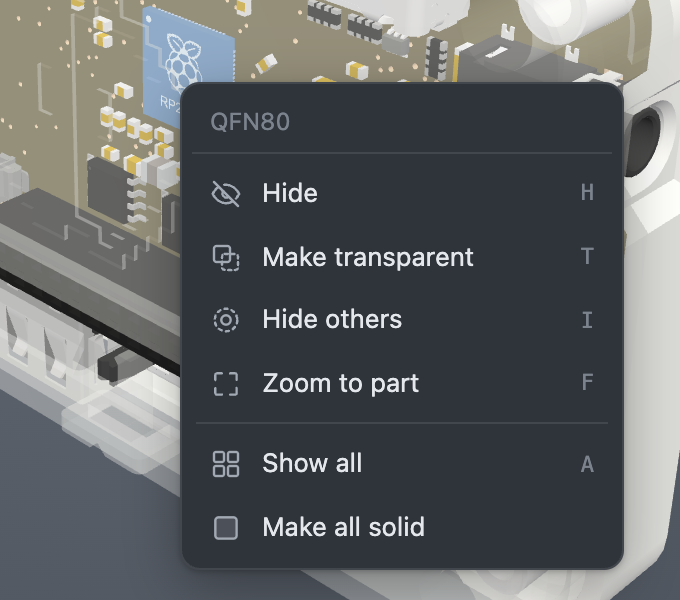
</p>

#### Parts panel

Filter box, **Expand all** / **Collapse all**, an eye icon to hide/show each part or sub-assembly.
Transparent parts show a dashed swatch, fully transparent assemblies a small transparency icon.
Drag the panel's right edge to resize it (double-click the edge to reset; remembered per browser).
On phones the panel opens with the **Parts** button.

<p align="center">
  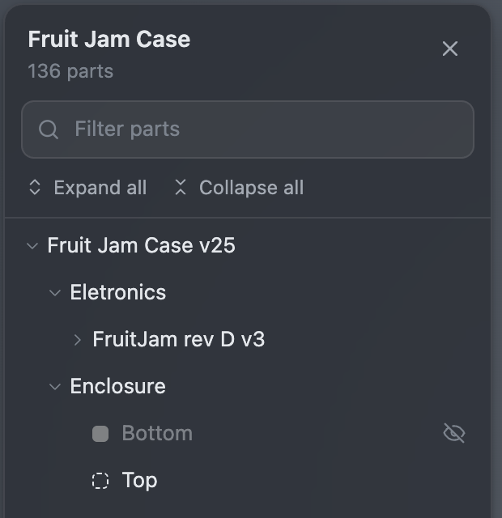
</p>

#### Toolbar

**Fit** · **Isolate** (show only the selection) · **Show all** · **Edges** · **Explode** ·
**Measure** · **Lights** · light/dark theme.

<p align="center">
  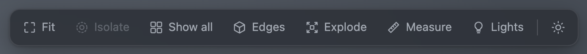
</p>

#### Isolate

**Isolate** (`I`, or **Hide others** in the menu) hides everything except the selection; **Show
all** (`A`) brings the rest back.

<p align="center">
  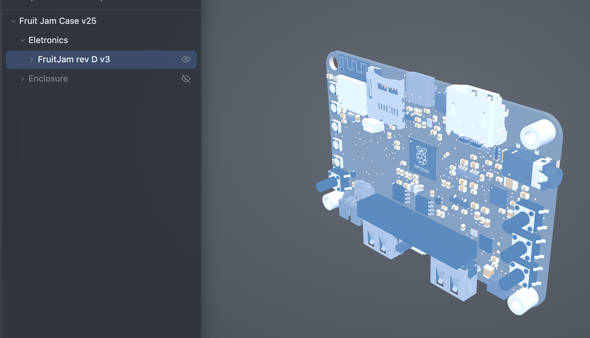
</p>

#### View cube

Top right. Click a face, edge or corner to snap to that view (26 views); drag it to orbit. In a
straight (face-on) view the curved arrows roll the view 90° left/right; the house button returns
to the default isometric view.

<p align="center">
  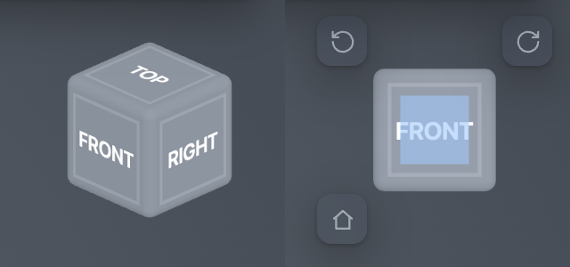
</p>

#### Exploded view

**Explode** (`X`) spreads the assembly level by level, with a distance slider; **Levels** sets how
many layers of sub-assemblies come apart (1 = only the top level).

<p align="center">
  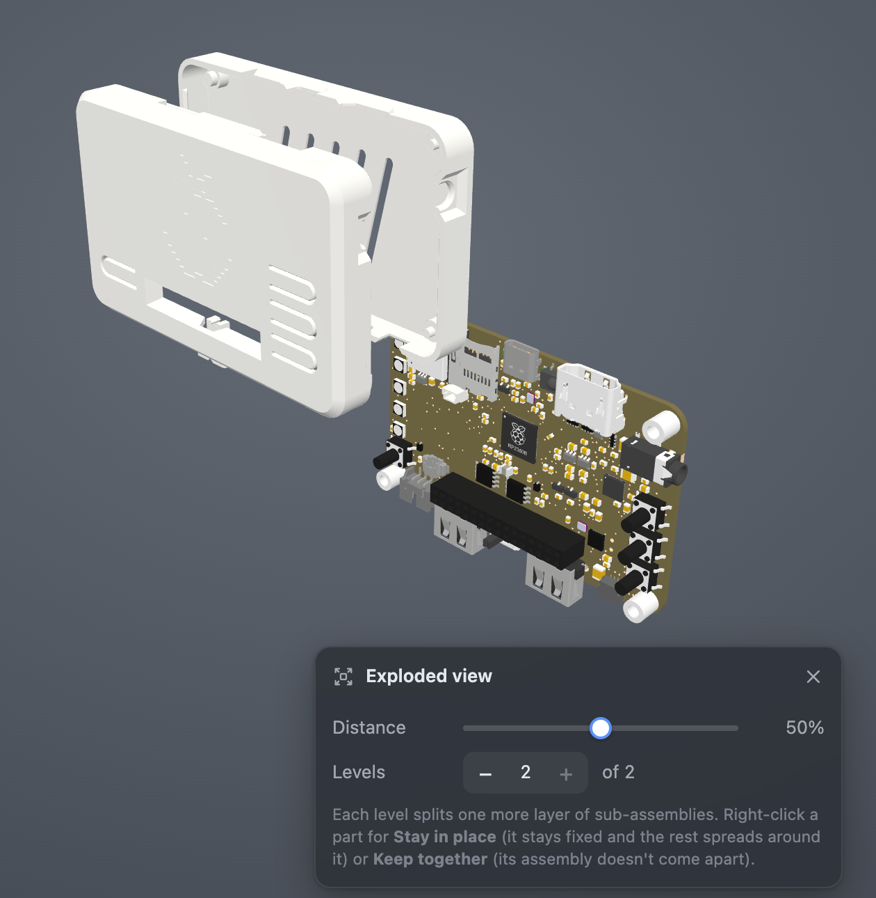
</p>

While it is on, the right-click menu has an **Exploded view** section with two tick options:
**Stay in place** (the part stays fixed and the rest spreads out around it) and **Keep together**
(its assembly doesn't come apart, e.g. a PCB with its components; from the 3D view this applies to
the part's parent assembly). Flagged rows get a small marker in the tree.

<p align="center">
  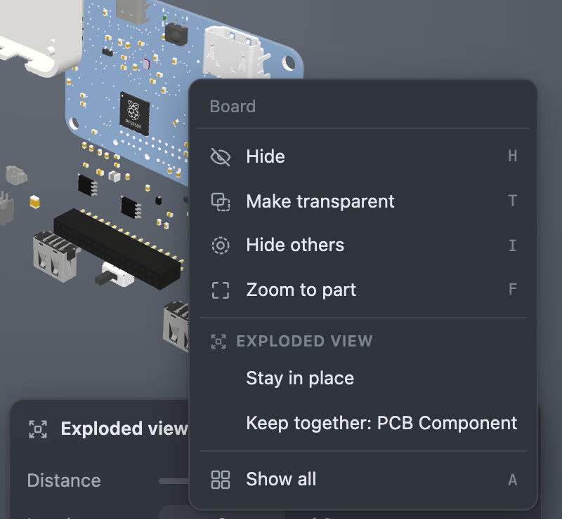
</p>

#### Measure

**Measure** (`M`): click two items to measure between them — corners (snaps to mesh vertices), flat
faces and holes/cylinders. Gives point/face/axis distances with ΔX/ΔY/ΔZ (in the CAD's axes),
angles between faces/axes, and the diameter of any hole or cylinder you click. Results are listed
in the panel (remove one with ×, or **Clear** all) and labelled in the 3D view; hover a row to find
its label. Values are in mm. Flat faces and corners are exact; hole diameters are fitted through
the mesh (shown as ≈). Measurements belong to the assembled model and are hidden while exploded.

<p align="center">
  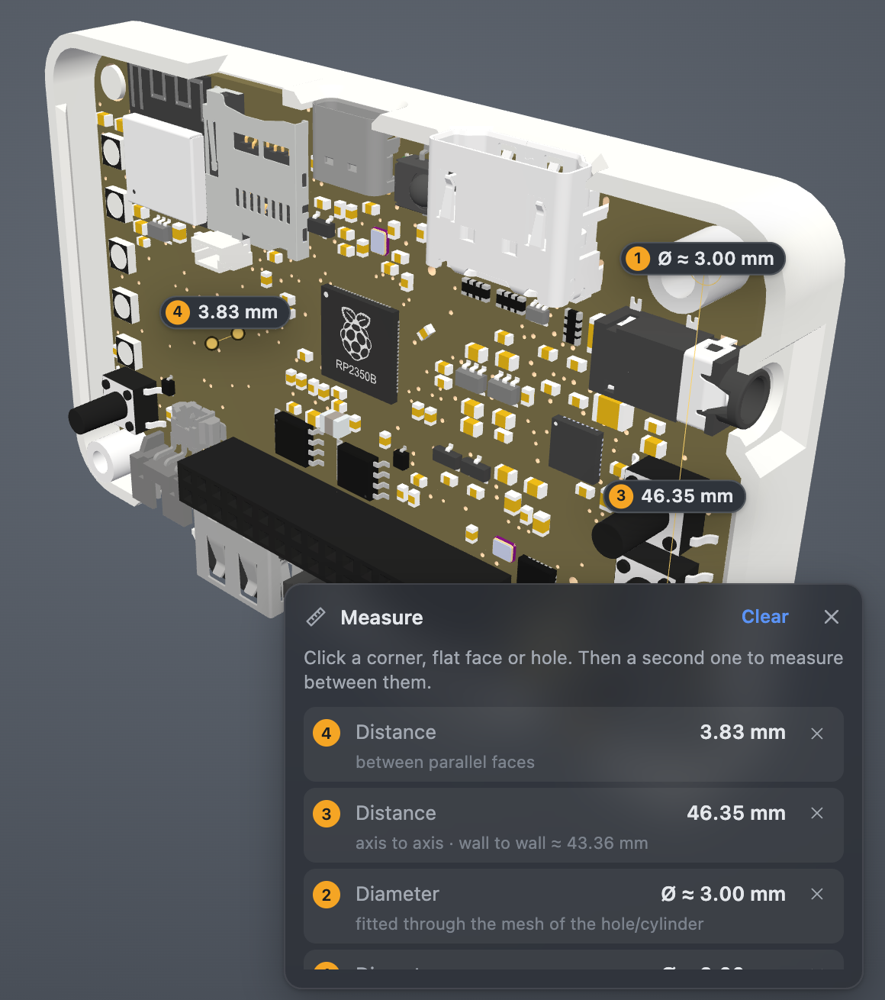
</p>

#### Lights

**Lights** (`L`): presets (Studio, Headlight, Soft, Dramatic) with colour temperature
(2700–8000 K) and brightness sliders; the choice is remembered.

<p align="center">
  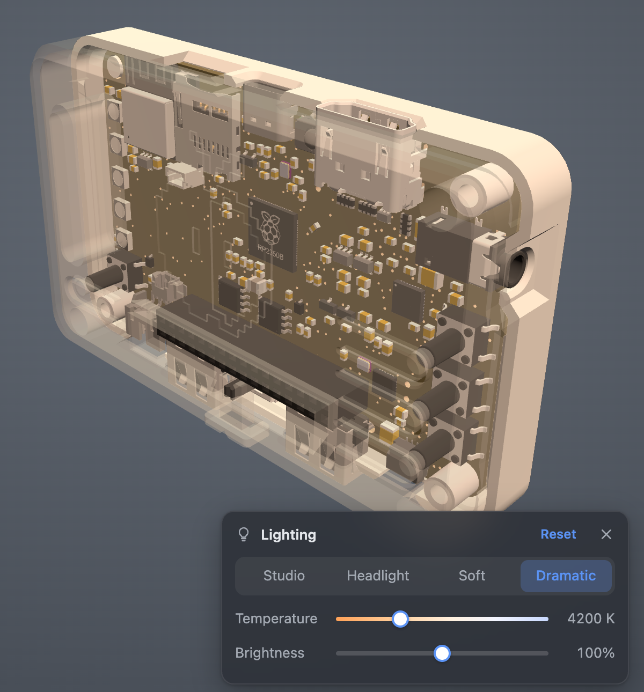
</p>

#### Edges

**Edges** (`E`) outlines the model's feature edges.

<p align="center">
  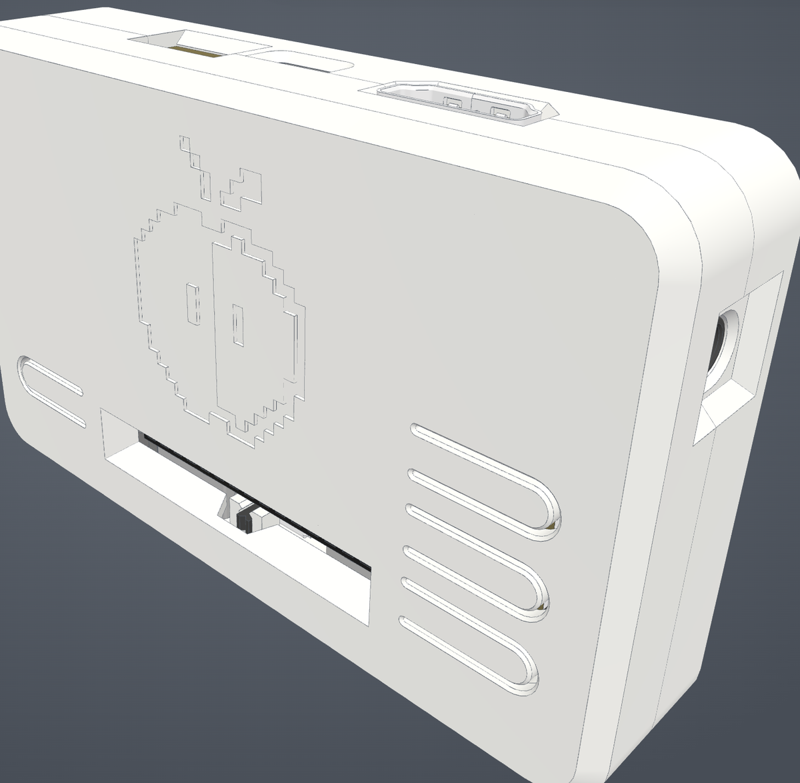
</p>

#### Light and dark theme

The theme follows the OS setting until toggled with the sun/moon button, then is remembered.

<p align="center">
  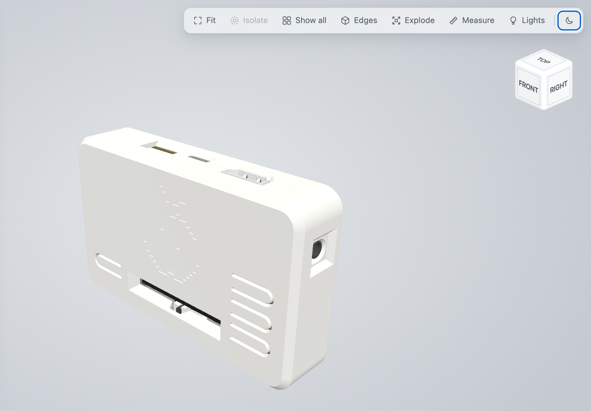
</p>

#### Keyboard

`F` fit · `H` hide · `T` transparent · `I` isolate · `A` show all · `E` edges · `X` explode ·
`M` measure · `L` lights · `Esc` deselect

## What is preserved (and the color caveat)

`step2html` reads the STEP through OpenCASCADE's **XCAF** layer, so it keeps:

- **geometry** (tessellated B-rep),
- the **assembly hierarchy**,
- real **part names** — resolved from the product prototypes, not the raw `NAUO…` instance
  ids, and including non-ASCII names (e.g. Cyrillic), and
- any **per-part colors that exist in the STEP**.

⚠️ **Colors are only as good as the STEP export.** A STEP file carries color only if the CAD
exported it. Some exports (SolidWorks with default settings, for example) contain a *single* color
for all parts, so the model renders monochrome — that is faithful to the file, not a converter bug.
To get per-part colors, re-export with appearance / color export enabled (and make sure the parts
actually have distinct appearances assigned). The tool prints how many distinct colors it found.

## Performance

CAD assemblies can be huge (one test model has ~2,300 parts / 1.2M triangles). Two things keep
the viewer fast and the page from crashing the browser:

- **Merged faces at conversion time.** OpenCASCADE otherwise writes one glTF primitive per
  B-rep face, which for that model meant ~93,000 draw calls — enough to peg the CPU and lock
  up the browser. The converter calls `SetMergeFaces`, collapsing each solid to a single
  primitive: **~1,900 draw calls instead of ~93,000**, same geometry and colors. This is the
  same idea CAD web viewers (eDrawings / HOOPS) rely on — batch geometry to minimize draw calls.
- **Lazy parts tree + render-on-demand.** The tree builds rows only as you expand them (not all
  ~96k instances up front), filtering searches a lightweight index, static transforms are frozen,
  and the scene only re-renders when something actually changes.

If a model is still heavy on a low-end device, export with a coarser `--tol-linear` (or the
**Coarse** detail in the app) to reduce triangles.

## Layout

```
step2html              launcher (bash) — provisions ./.venv, runs the converter
step2html.py           the converter (Python + OpenCASCADE/XCAF)
step2html_gui.py       the desktop app (PySide6), runs the converter as a child process
requirements.txt       the converter's single dependency (cadquery-ocp)
lib/
  three.min.js         three.js r136 (UMD, offline)
  GLTFLoader.js        glTF loader (UMD)
  OrbitControls.js     camera controls (UMD)
  viewer_template.html HTML template (parts tree + viewer)
packaging/             desktop app build scripts (macOS, Linux, Windows)
docs/images/           README screenshots
.venv/                 created on first run (Python env with cadquery-ocp)
```

## Building from source

Requirements for the command line from a checkout:

- Python 3.8+ (`python3` on PATH)
- macOS or Linux with a `pip`-installable `cadquery-ocp` wheel (current macOS/Linux,
  x86-64 and Apple Silicon)
- Internet access on the **first run only**, to install the dependency

To run the desktop app from source: `pip install cadquery-ocp PySide6-Essentials` and
`python3 step2html_gui.py`. To build the packages yourself see
[packaging/README.md](packaging/README.md).

## License

step2html is released under the [MIT License](LICENSE).

It builds on third-party components under their own licenses: three.js with its OrbitControls and
GLTFLoader (MIT; embedded in every generated viewer), cadquery-ocp (Apache-2.0) and OpenCASCADE
(LGPL-2.1 with exception) for the converter, and, in the desktop app packages, Qt/PySide6 (LGPL-3.0),
VTK (BSD-3-Clause) and Python (PSF License).

The screenshots show the **Fruit Jam Case** model by Adafruit Industries, from
[adafruit/Adafruit_CAD_Parts](https://github.com/adafruit/Adafruit_CAD_Parts) (MIT License).
